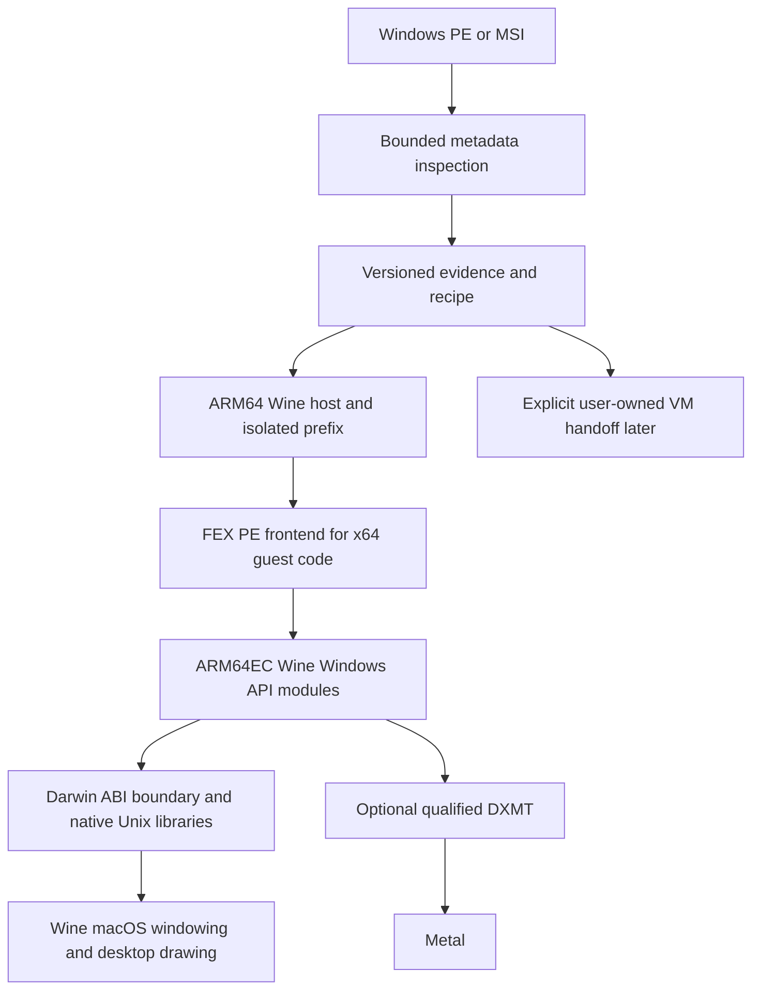

# ADR-001: Native compatibility first, conditional on stock-Mac authorization

Date: 2026-10-10. Status: **Proposed / CONDITIONAL GO**. No implementation acceptance gates have passed beyond local capability probes. Gate0A development authorization and Gate0B stock-Mac redistribution authorization are separate. Decision classification: **INFERRED**. Evidence: [01 landscape](01-landscape.md), [02 native Wine](02-native-arm64-wine.md), [03 FEX](03-fex-hangover.md), [04 graphics](04-graphics.md), [05 alternatives](05-alternatives.md), [06 licensing](06-licensing-security.md), [latest probe](experiments/README.md).

## Context and decision

The target is a free Windows application runtime whose preferred path needs neither Windows nor Rosetta, with direct macOS desktop windows and maintainable public source. macOS26.4–26.5 changes remove several historical platform obstacles, and a commercial preview reports the exact CPU/API architecture. They also introduce a restricted-authorization dependency whose independent distribution conditions are unresolved.

Choose **A as the prototype foundation**: ARM64 Mach-O Wine host, ARM64EC Wine PE modules for x64 processes, FEX PE CPU emulation, native ARM64 Darwin helper, and Wine macdrv. Ordinary Windows ARM64 applications require their matching PE module architecture; do not conflate them with EC modules. Initially keep upstream wineserver synchronization and Wine desktop rendering. Add DXMT for qualified D3D10/11 use after the CPU/GUI gates.

The source/build manifest is part of the runtime, not optional documentation. Every supported tuple identifies Wine, translator, macdrv, graphics, toolchain and patches. Select app-specific versions through deterministic, versioned recipes. Unknown applications receive a conservative tested default or explicit unsupported diagnosis, never a fictitious compatibility rating. No AI selector is justified: PE/import metadata, OS/capability checks and recorded tests suffice for the initial decisions.

## Selected boundaries

This is an intended architecture, not a diagram of locally reproduced execution. Prefix isolation supplies reproducible state; security isolation is a separate host authority boundary. Do not describe a prefix as a sandbox.

## Rejected or deferred alternatives

| Alternative | Decision and evidence-based reason |
|---|---|
| B: Windows ARM VM as primary | Reject for this vision: technically practical with UTM, but requires proprietary Windows/license and guest lifecycle; cannot provide the requested no-Windows preferred path. Keep as explicit external option. |
| C: integrated native+VM product from day one | Defer: the two backends are separately useful, but state migration, provisioning, licensing, security and qualification costs are additive. No corpus yet proves sufficient incremental compatibility to justify them. |
| D: ARM Linux VM+Wine/FEX | Retain contingency if authorization blocks native distribution. Avoids Windows and Darwin translator plumbing but needs remoted GUI, guest lifecycle and graphics qualification. Not equivalent to direct native windows. |
| Entire Linux FEX frontend port | Reject initial scope: Windows PE frontend bypasses ELF/rootfs/Linux syscall emulation and has a public integration seam. |
| New translator or custom Windows API layer | Reject: mature upstream components exist; a small project would inherit instruction and API conformance obligations without demonstrated benefit. |
| Rosetta Wine / proprietary D3DMetal core | Reject long-term preferred path because it violates explicit requirements. Useful separately licensed comparison baseline only. |
| General DXVK/vkd3d over stock MoltenVK | Defer: pinned required-feature mismatches, not merely presumed overhead. |
| Experimental fast Wine synchronization fork | Defer: retain baseline conformance before optimizing. Hardware TSO and Win32 wait-object semantics are distinct. |

## Consequences and reversibility

Native execution avoids a guest OS structurally, but performance and memory benefits remain hypotheses until measured. ARM64EC reduces translated API code, while adding ABI/unwind/toolchain coupling. Apple's public platform APIs are proprietary host services; using them is compatible with an open-source runtime, but the entitlement grant remains vendor-controlled and cannot be made platform-independent by source licensing.

Limit private patches to a reviewed, itemized platform queue. Prefer upstream acceptance; report findings to maintainers, but FEX and DXMT upstream code must follow their human-authorship policies. If the release grant cannot be obtained, stop A's product commitment and reassess D; keep parsers, manifests, fixtures and compatibility evidence reusable. If a new translated graphics path proves superior in measured applications, add it as a recipe capability rather than rewriting the whole runtime.

## Acceptance of this ADR

This proposed decision becomes accepted only when Gates0A and0B plus milestones1–4 in the roadmap pass. Otherwise record the failing gate and replace the decision. A working game screenshot, a universal app bundle, a successful native launcher, or a development profile tied to one Mac is insufficient.
